<p align="center"></p>

# Graticule

코딩 에이전트를 위한 지도 제작 스킬: 스킬 1개, 지도 유형 5가지, 지역 13곳 또는 직접 만든 GeoJSON, 규칙 25개, 언어 9개. 잘못된 지도는 그리지 않고, 그 이유를 알려 줍니다.

> **빠른 시작.** `npx skills add Arthur031221/Graticule`을 실행한 다음 에이전트에게 이렇게 말하세요. "deaths.csv로 나라별 코로나19 사망자 수 지도를 만들어 줘."

[English](README.md) | [繁體中文](README.zh-TW.md) | [简体中文](README.zh-CN.md) | [日本語](README.ja.md) | [한국어](README.ko.md) | [Español](README.es.md) | [Français](README.fr.md) | [Deutsch](README.de.md) | [Português](README.pt-BR.md)

[](https://github.com/Arthur031221/Graticule/actions/workflows/ci.yml) [](LICENSE) [](https://arthur031221.github.io/Graticule/) [](https://github.com/Arthur031221/Graticule/releases)

<p align="center"><a href="https://arthur031221.github.io/Graticule/">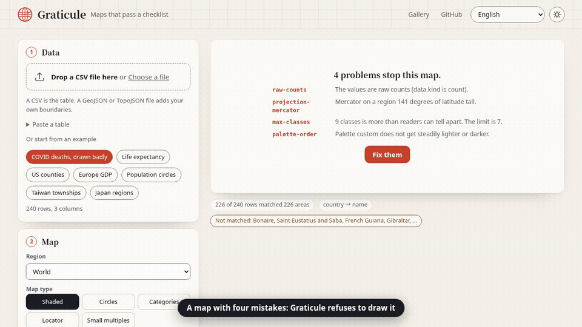</a></p>

ISO 3166 국가 이름 **235개 중 232개**가 이름만으로 올바른 폴리곤에 연결됩니다. 잘못 연결된 것은 하나도 없습니다. Natural Earth의 영어 이름과 정확히 일치시키는 방법으로는 202개입니다.
<sub>이름은 datasets/country-codes(official_name_en)에서 가져와 Natural Earth 1:50m와 결합했고, 잘못된 결합은 각 이름의 ISO 코드와 대조해 셌습니다. 다른 공개 목록 다섯 개에서도 결과는 같습니다. [docs/verification.md](docs/verification.md)를 보세요.</sub>

| 스킬이 없는 코딩 에이전트 | 같은 에이전트에 Graticule를 더한 경우 |
| --- | --- |
| 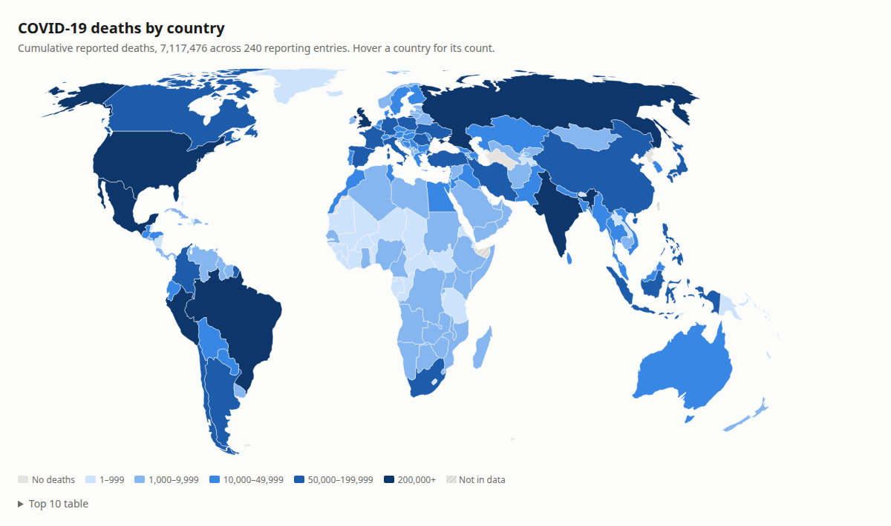 | 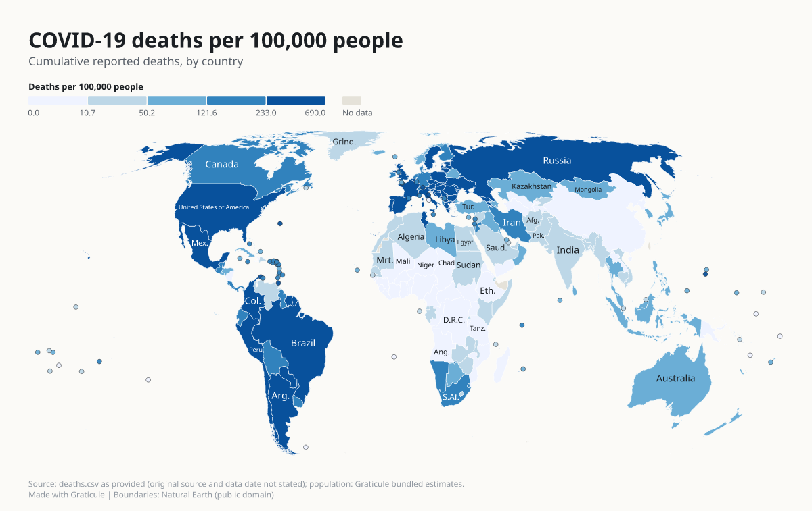 |
| 사망자 수 원시 건수를 그대로 칠했습니다. 범례가 건수의 로그 구간이라서 인구가 많은 나라가 진하게 나옵니다. 출처 줄이 없습니다. | 인구로 나누고, 정적 도법을 쓰고, 출처 줄을 달고, 일치하지 않은 14개 행을 이름으로 나열했습니다. 22초 걸렸습니다. |

같은 프롬프트, 같은 파일, 같은 에이전트(Sonnet 5.5)의 새 세션입니다. 스킬 없이 돌린 네 세션은 그 에이전트 둘, Codex 둘 모두 원시 건수를 칠했습니다. 기록은 [eval/runs](eval/runs)에 있습니다.

제가 쓴 것은 에이전트가 서둘러 지도를 그릴 때 건너뛰는 규칙들과, 그 규칙을 통과하기 전에는 실행되지 않는 렌더러입니다. 새로운 지도 라이브러리가 아닙니다.

## 이름의 뜻

graticule은 지도 위에 그려진 위도선과 경도선의 격자입니다. 독자는 이것으로 지도가 말하는 위치에 맞게 그려졌는지 확인합니다. 이 프로젝트는 에이전트가 그리는 지도에 같은 일을 합니다. 실수는 늘 같은 것들입니다.

- **비율이 아니라 건수.** 나라별 사망자 수를 그대로 칠하면 사람이 어디에 사는지만 보여 줍니다. Graticule는 종류(kind)를 밝히라고 요구하고, 값이 인구와 같은 순서로 늘어서 있으면 그것을 알아채서 나눕니다.
- **세계 지도에 메르카토르.** 그린란드가 아프리카만큼 커 보입니다. 기본은 정적 도법이고, 위도 폭이 20도를 넘는 지역에서는 메르카토르를 거부합니다.
- **사라지는 행.** "Korea, Rep."가 "South Korea"와 일치하지 않는데 아무도 알려 주지 않습니다. 결합되지 않은 행은 모두 가장 가까운 이름과 함께 나열됩니다. 두 곳에 들어맞는 이름을 짐작으로 고르는 일은 없습니다.
- **UTF-8이 아닌 파일.** Windows의 스프레드시트는 표를 Big5, Shift_JIS, Windows-1252로 저장하는 경우가 많고, UTF-8로 읽으면 한 행도 맞지 않습니다. Graticule은 파일이 UTF-8이 아니라고 알려 주고 Windows-1252로 읽으며, `--encoding big5`나 `data.encoding`으로 인코딩을 지정할 수 있습니다.
- **무지개 팔레트.** 밝기가 오르내리면 데이터에 없는 경계선이 생깁니다. 팔레트는 밝기가 한 방향으로 변해야 하고, 제가 시뮬레이션하는 세 가지 색각 이상에서도 색이 서로 떨어져 있어야 합니다.
- **빈 상자가 되는 라벨.** 중국어, 일본어, 한국어 라벨에는 글꼴이 필요합니다. 출력마다 사용하는 글리프만 담은 Noto Sans CJK 부분 집합을 넣습니다.
- **출처 없음.** 출처 줄이 없는 지도는 거부합니다.

## 무엇을 검사하나

규칙은 25개이고, 각각 알기 쉬운 이유가 검사 결과 옆에 표시됩니다. 오류는 지도를 멈춥니다. `--fix`는 기계적으로 고치는 방법이 하나뿐인 것을 고치고, `--allow <id>`는 규칙을 받아들이면서 보고서에 기록을 남깁니다.

| 규칙 | 잡아내는 것 |
| --- | --- |
| `source-required` | 출처 줄이 없는 지도. |
| `title-required` | 제목이 없는 지도. |
| `legend-title` | 숫자가 무엇인지 밝히지 않은 범례. |
| `kind-undeclared` | 값이 건수일 수 있는 단계구분도. |
| `table-ragged` | 셀 수가 맞지 않는 표의 행. |
| `join-blank` | 지역 이름이 비어 있는 행. |
| `join-failed` | 대부분의 행이 어느 지역과도 맞지 않는 키 열. |
| `join-unmatched` | 어디에도 맞지 않는 행. 가까운 이름과 함께 나열합니다. |
| `join-ambiguous` | 둘 이상의 지역에 들어맞는 이름. |
| `duplicate-keys` | 한 지역에 행이 여러 개인 경우. 예를 들어 여러 해가 한 열에 들어 있을 때. |
| `raw-counts` | 단계구분도의 원시 건수. `--fix`는 인구로 나눕니다. |
| `projection-mercator` | 위도 폭이 20도를 넘는 지역에서의 메르카토르. |
| `projection-not-equal-area` | 넓은 지역의 단계구분도가 면적을 왜곡하는 도법을 쓰는 경우. |
| `max-classes` | 7개를 넘는 구간. |
| `class-breaks-coverage` | 일부 값에 색이 없게 만드는 구간 경계. |
| `empty-class` | 어느 지역도 쓰지 않는 범례 구간. |
| `skewed-classes` | 등간격이나 수동 구간에서 지도 대부분이 한 구간에 몰리는 경우. |
| `palette-order` | 밝기가 한 방향으로 변하지 않는 팔레트. |
| `cvd-separation` | 색각 이상 시뮬레이션에서 너무 가까워지는 색. |
| `diverging-center` | 중심값이 없는 발산형 팔레트. |
| `too-many-categories` | 8개를 넘는 범주. |
| `normalize-missing` | 나눌 인구나 면적이 없는 지역. |
| `values-skipped` | 셀이 숫자가 아니거나 분모가 없거나 0이어서 제외된 행. |
| `no-data-share` | 대부분이 회색인 지도. |
| `label-overlap` | 서로 겹쳐 찍힌 라벨. |

정확한 조건과 기준값은 [docs/rules.md](docs/rules.md)에 있습니다.

## 설치

<details open>
<summary><b>Codex와 위에서 쓴 에이전트</b> (제가 시험한 두 가지)</summary>

```
npx skills add Arthur031221/Graticule
```

프로젝트 안에서 이 명령은 `.agents/skills/graticule`(Codex가 읽습니다)을 만들고, 고른 다른 에이전트의 스킬 폴더에 연결합니다. 그다음에는 평소 말로 지도를 부탁하면 됩니다.

</details>

<details>
<summary><b>Cursor, Gemini CLI, OpenCode와 그 밖의 에이전트</b></summary>

같은 명령을 실행하고, `skills` 프로그램이 물으면 에이전트를 고릅니다. 이 에이전트들은 제가 직접 돌려 보지 않았습니다. 에이전트에 스킬 폴더가 있다면 `skills/graticule`을 그 안에 복사하세요. 크기는 약 14 MB이고 다른 것은 필요 없습니다.

</details>

<details>
<summary><b>스킬 업로드를 받는 채팅 앱</b></summary>

저장소를 복제한 뒤 `npm run package:skill`로 `graticule-skill.zip`을 만들거나 릴리스에서 받습니다. 앱이 사용자 지정 스킬을 받는 곳에 업로드하세요. 이 스킬은 프로그램을 실행하므로 코드 실행이 켜져 있어야 합니다.

</details>

<details>
<summary><b>명령줄만</b></summary>

```
npx -y github:Arthur031221/Graticule render map.json
```

또는 복제한 뒤 `node skills/graticule/scripts/graticule.mjs --help`를 실행합니다. Node 20 이상이 필요하고 네트워크는 필요 없습니다.

</details>

<details>
<summary><b>브라우저에서</b></summary>

[플레이그라운드](https://arthur031221.github.io/Graticule/)를 엽니다. CSV를 끌어다 놓고, 검사기가 찾아낸 문제를 고친 뒤 SVG, PNG, PDF 또는 인터랙티브 HTML 페이지를 내려받습니다. 모든 처리는 페이지 안에서 이루어지고 아무것도 업로드되지 않습니다. 화면은 아홉 가지 언어로 되어 있습니다. GeoJSON 또는 TopoJSON 파일을 표 옆에 놓으면 직접 만든 경계로 그릴 수 있습니다.

</details>

## 사용법

<p align="center">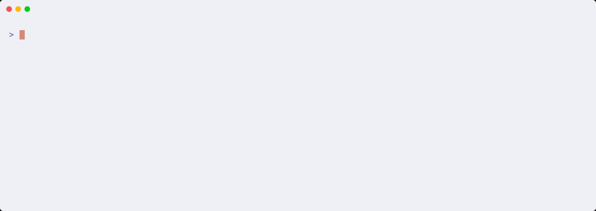</p>

```
graticule join deaths.csv --region world     # 무엇이든 그리기 전에, 어떤 행이 어떤 지역과 맞는지 확인
graticule check map.json                     # 모든 결과를 이유와 함께 표시
graticule render map.json --fix -f svg,png   # 오류마다 가장 작은 수정을 적용한 뒤 파일을 출력
```

명세는 작은 JSON 파일입니다.

```json
{
  "title": "COVID-19 deaths per 100,000 people",
  "source": "WHO COVID-19 dashboard, up to 2026-09-20",
  "region": "world",
  "data": { "file": "deaths.csv", "key": "country", "value": "deaths", "kind": "count" }
}
```

`render`는 `map.svg`, `map.png`, 필요하면 `map.pdf`와 `map.html`, 그리고 `map.check.json`을 씁니다. 보고서에는 무엇이 일치했는지, 구간 경계, 모든 검사 결과가 들어 있습니다. 전체 안내는 [docs/usage.md](docs/usage.md), 항목 목록은 [docs/config.md](docs/config.md)를 보세요.

## 지도와 지역

지도는 다섯 가지입니다. 단계구분도, 비례 원, 범주, 작은 지구본이 붙은 위치도, 범례 하나를 공유하는 작은 다중 지도입니다. 지역은 열세 곳입니다. 세계, 여섯 대륙, 미국의 주와 카운티(알래스카, 하와이, 푸에르토리코는 삽입 지도), 대만의 현·시와 향진시구, 일본의 도도부현, 대한민국의 도와 광역시입니다. 모두 내장되어 있어서 그리기는 오프라인으로 됩니다. 그 밖의 지역은 GeoJSON 또는 TopoJSON 파일을 주면 됩니다. `graticule init table.csv --boundaries states.geojson`. 피처마다 값이 다른 속성은 모두 조인용 키가 되고, 투영은 범위에 맞춰 고른 면적을 보존하는 도법입니다. [docs/config.md](docs/config.md)를 보세요.

| | | |
| --- | --- | --- |
| [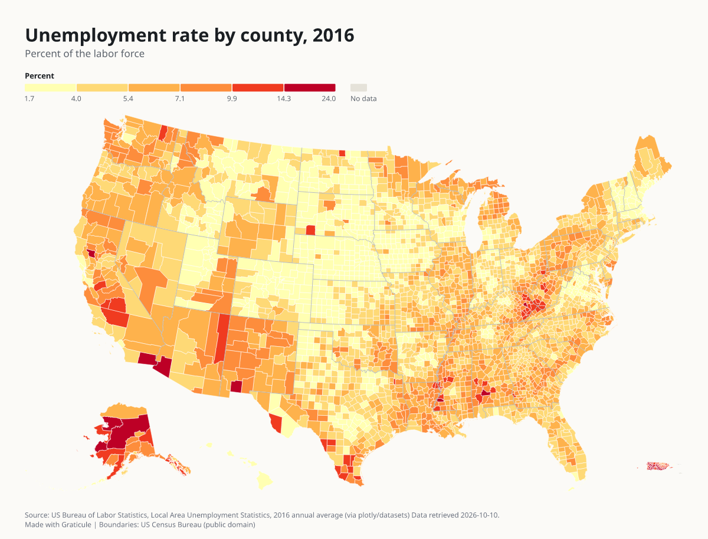](docs/gallery.md) | [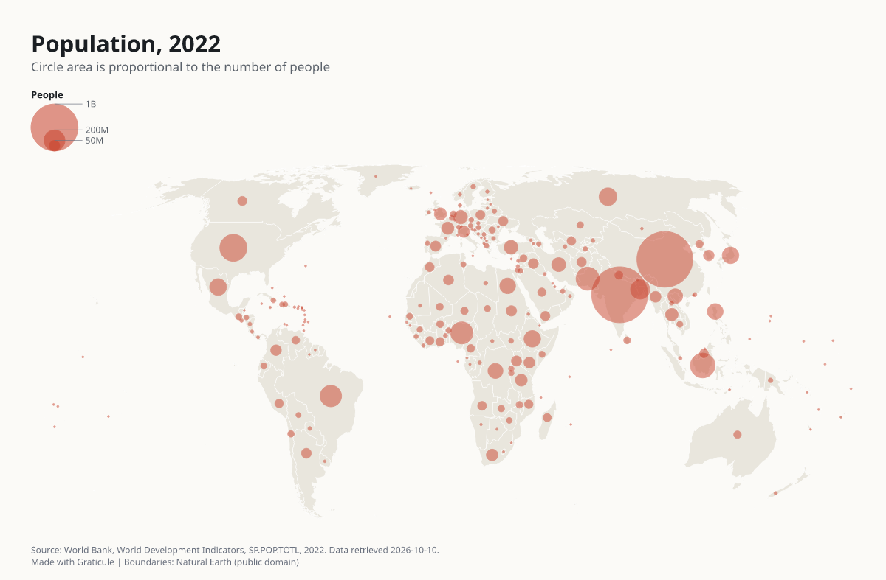](docs/gallery.md) | [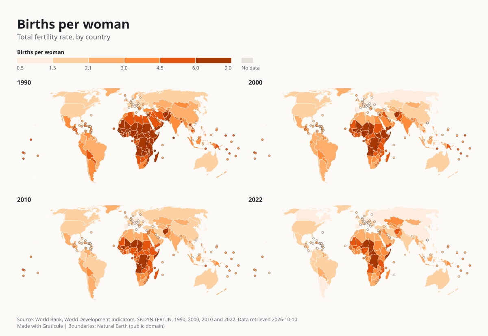](docs/gallery.md) |
| [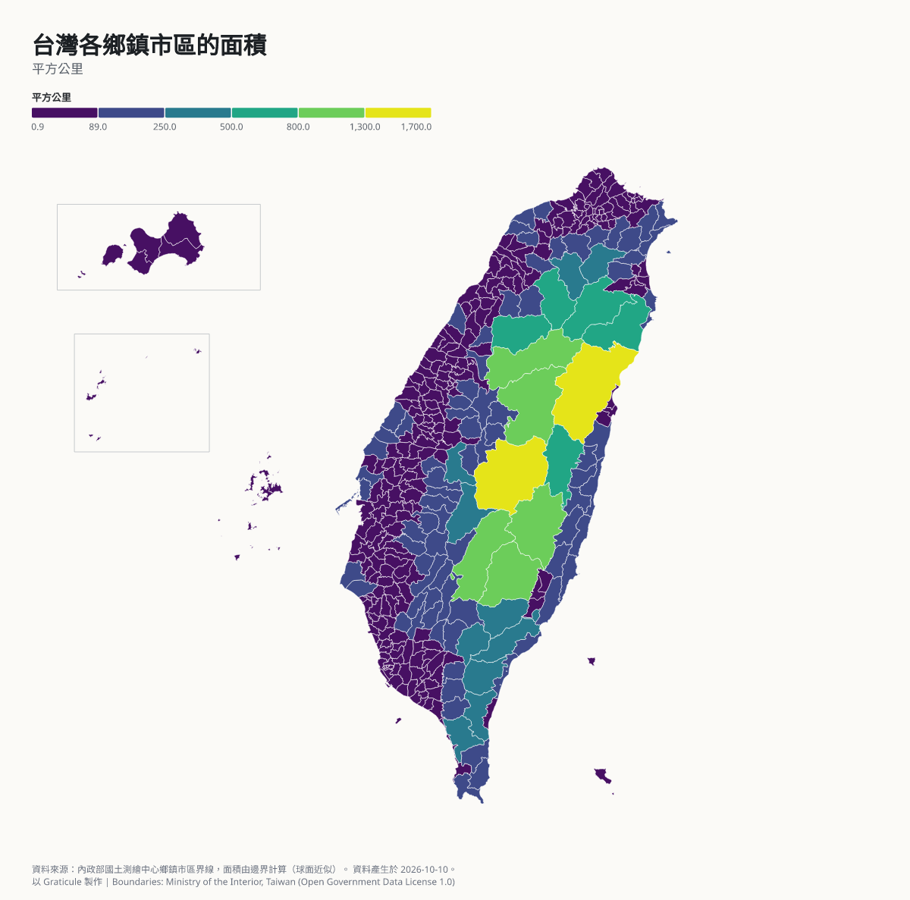](docs/gallery.md) | [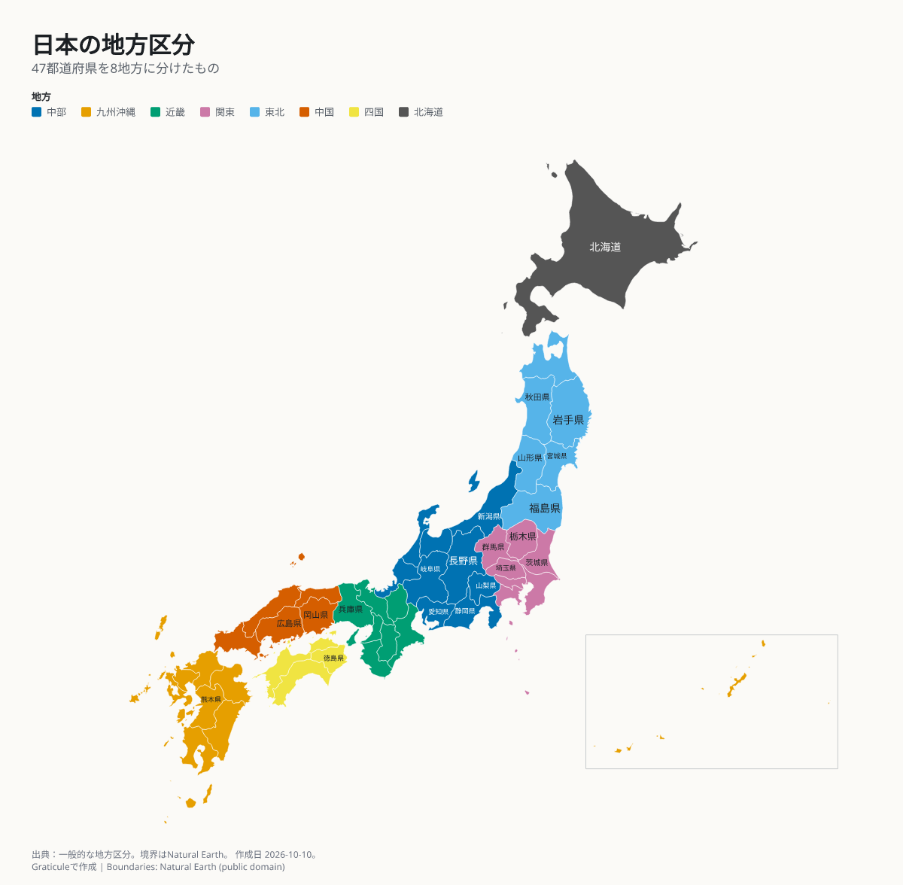](docs/gallery.md) | [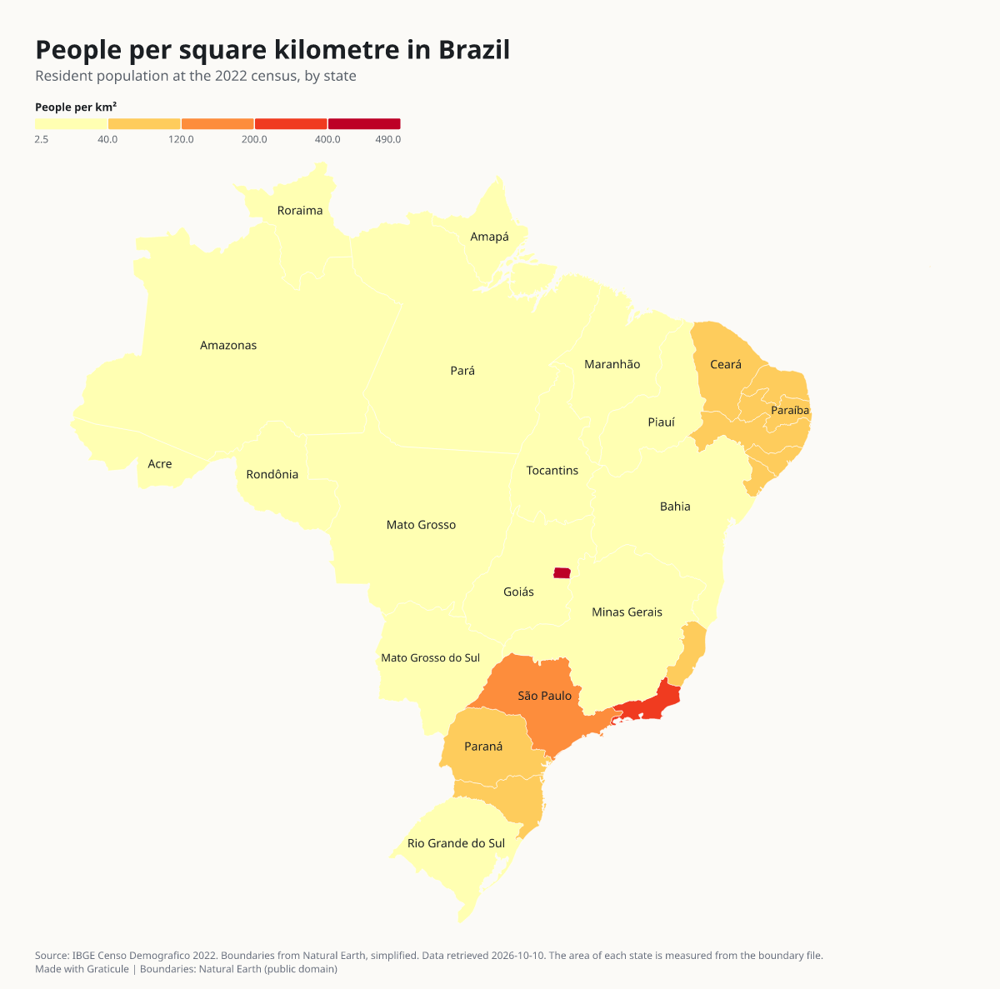](docs/gallery.md) |

[docs/gallery.md](docs/gallery.md)에 열일곱 장이 모두 있습니다. 각각 요청한 프롬프트, 명세, 데이터, 검사 기록이 붙어 있습니다.

## 아홉 가지 언어의 라벨

<p align="center">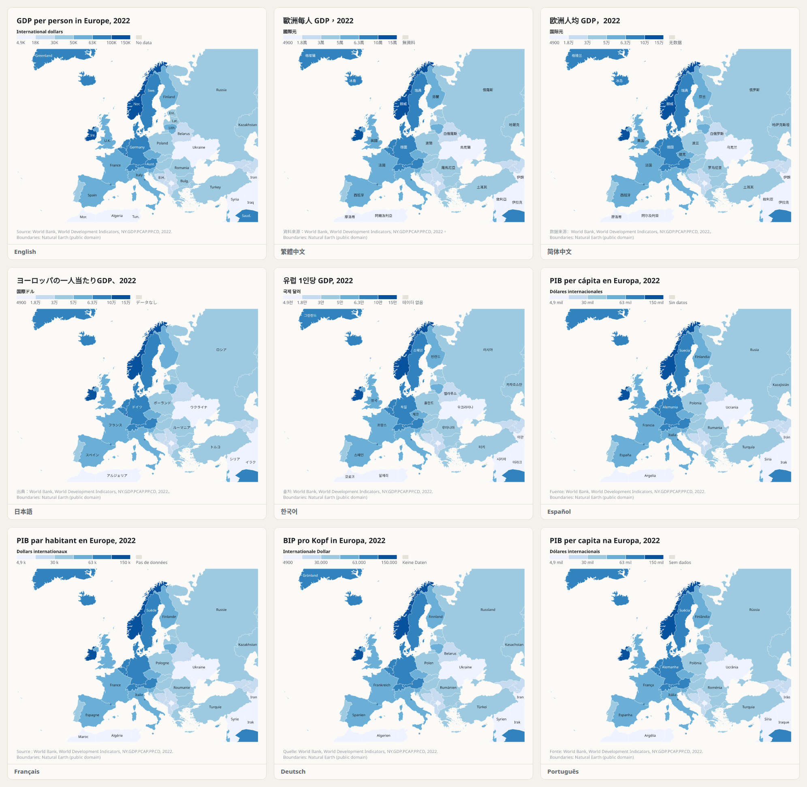</p>

영어, 번체와 간체 중국어, 일본어, 한국어, 스페인어, 프랑스어, 독일어, 브라질 포르투갈어입니다. `--lang ko`는 지도 라벨과 메시지의 언어를 바꿉니다. 플레이그라운드, 메시지, 이 README는 각 언어로 번역되어 있습니다.

## 실제 시스템과 대조한 결과

각 검사는 이 저장소의 스크립트로 실행되고, CI가 대부분을 반복합니다. 수치와 방법은 [docs/verification.md](docs/verification.md)에 있습니다.

| 대상 | 비교한 것 | 결과 |
| --- | --- | --- |
| 도법 12가지 | PROJ 9.8.1, 각 3,000개 점 | 11가지는 0.00001 m 이내로 일치, Robinson은 배율 하나를 맞춘 뒤 10.2 km |
| 분위수, 등간격, Jenks 구간 | mapclassify 2.11.0, 45개 사례 | 범례용으로 경계를 반올림하기 전에는 경계와 개수가 같음 |
| CIELAB, CIEDE2000, 색각 시뮬레이션 | colour-science 0.4.7, colorspacious | 0.02 이내, 255 중 2 이내 |
| 이름 결합 | 공개 국가 목록 6개 | 이름 1,301개에서 잘못된 결합 없음 |
| 건수와 비율 | 세계은행 지표 33개 | 비율 25개 중 0개를 오탐, 건수 8개는 8개 모두 잡아냄 |
| SVG, PDF, PNG | fontTools, pypdf, Pillow | 모든 글리프와 글꼴이 포함되고 크기도 맞음 |

에이전트 세션은 작은 표본입니다. 프롬프트 둘, 에이전트 둘, 각각 두 번씩입니다. 예시로 읽어 주세요. 프롬프트와 실행 스크립트는 [eval](eval)에 있습니다.

## 한계

- 경계는 Natural Earth(국가는 1:50m), 2017년 미국 인구조사 파일, 대만 내정부 파일에서 왔습니다. 지도를 그리기 위한 것이며 측량용이 아닙니다. 프랑스령 기아나, 마르티니크, 과들루프, 마요트, 레위니옹은 프랑스의 일부입니다. 지브롤터와 토켈라우에는 폴리곤이 없습니다.
- 미국 카운티는 2017년판이라서 코네티컷주의 계획 지역과 알래스카의 새 인구조사 구역은 결합되지 않습니다.
- 대만 향진시구에는 영어와 번체 중국어 이름만 있습니다. 일본의 오가사와라 제도와 아마미 제도, 대만의 우추는 그려지지 않습니다.
- 건수 감지기는 기준값 0.6의 경험칙입니다. `data.kind`를 밝히면 건너뜁니다.
- `1,234` 같은 셀은 1234로 읽습니다. 같은 열의 다른 셀이 소수점에 쉼표를 쓰고 있으면 그에 따릅니다. 나머지 숫자 규칙은 [docs/config.md](docs/config.md)에 있습니다.
- 글꼴은 각 언어의 흔한 글자를 다룹니다(예를 들어 번체 중국어는 Big5 1수준의 5,401자). 그 밖의 글자는 `glyphs-missing`으로 보고됩니다. 오른쪽에서 왼쪽으로 쓰거나 글자 모양을 조합해야 하는 문자는 지원하지 않습니다.
- 미국 지도에서 알래스카는 본토 48개 주의 35% 축척으로 그려집니다. 면적은 같은 구획 안에서만 비교할 수 있습니다.
- 라벨은 탐욕적 배치기를 씁니다. 빽빽한 지도에서는 일부가 빠지고, 보고서가 그 수를 셉니다.
- 직접 만든 경계는 있는 그대로 그립니다. 아주 큰 파일은 느리고 메모리를 많이 쓰므로, mapshaper 같은 도구로 먼저 단순화하세요. 좌표는 경도와 위도여야 합니다. `--fix`가 원시 개수를 인구로 나누려면 인구 속성이 필요합니다.

## 더 보기

[설치](docs/install.md), [사용법](docs/usage.md), [설정](docs/config.md), [지역](docs/regions.md), [규칙](docs/rules.md), [데이터와 라이선스](docs/data.md), [구조](docs/architecture.md), [검증](docs/verification.md), [기여하기](CONTRIBUTING.md), [변경 내역](CHANGELOG.md).

Natural Earth, 미국 인구조사국, 대만 내정부, Noto 글꼴, ColorBrewer, d3, pdfkit, resvg, HarfBuzz 덕분에 만들 수 있었습니다. 라이선스는 [NOTICE.md](NOTICE.md)에 있습니다.

MIT 라이선스. [LICENSE](LICENSE)를 보세요.

Assisted by Claude/Codex.
