# Gallery

17 maps built from public data. Each one is a spec and a table in `gallery/<name>`, so `graticule render gallery/<name>/spec.json` redraws it. The check log is the report the checker wrote. `npm run gallery` fetches the data again and rebuilds everything.

## Life expectancy at birth, 2019

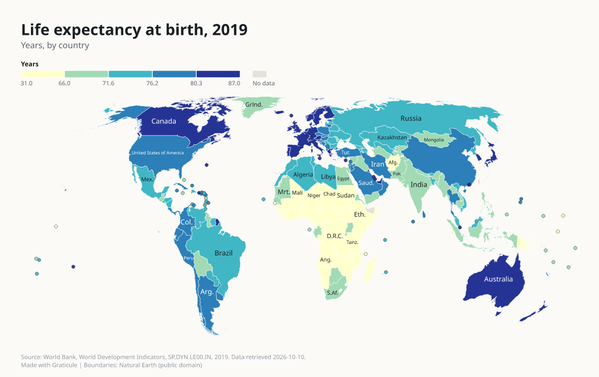

Prompt: "Map life expectancy by country."

Region `world`, type `choropleth`. Checker notes: join-unmatched. [Spec](../gallery/life-expectancy/spec.json), [data](../gallery/life-expectancy/data.csv), [check log](../gallery/life-expectancy/check.json).

## COVID-19 deaths per 100,000 people

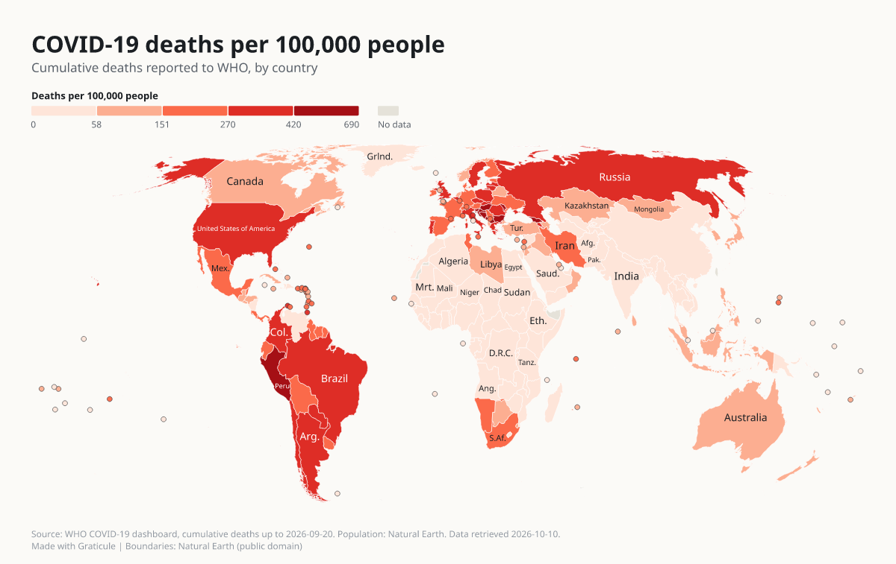

Prompt: "Map COVID deaths by country from deaths.csv."

Region `world`, type `choropleth`. Checker notes: join-unmatched. [Spec](../gallery/covid-deaths/spec.json), [data](../gallery/covid-deaths/data.csv), [check log](../gallery/covid-deaths/check.json).

## Carbon dioxide emissions per person, 2020

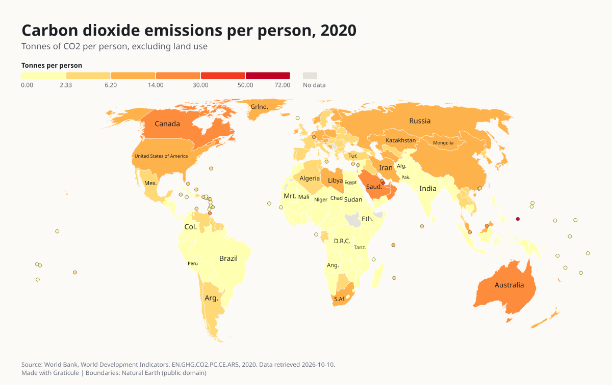

Prompt: "Show CO2 emissions per person for every country."

Region `world`, type `choropleth`. Checker notes: join-unmatched. [Spec](../gallery/co2-per-capita/spec.json), [data](../gallery/co2-per-capita/data.csv), [check log](../gallery/co2-per-capita/check.json).

## People using the internet, 2022

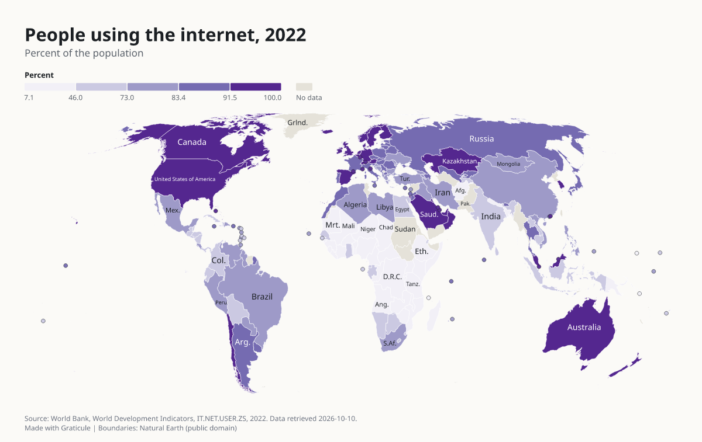

Prompt: "Which countries have the most people online? Use a map."

Region `world`, type `choropleth`. The checker found nothing to report. [Spec](../gallery/internet-users/spec.json), [data](../gallery/internet-users/data.csv), [check log](../gallery/internet-users/check.json).

## Population, 2022

Prompt: "Draw the population of every country as circles on a map."

Region `world`, type `symbols`. Checker notes: join-unmatched. [Spec](../gallery/population-symbols/spec.json), [data](../gallery/population-symbols/data.csv), [check log](../gallery/population-symbols/check.json).

## World Bank income groups

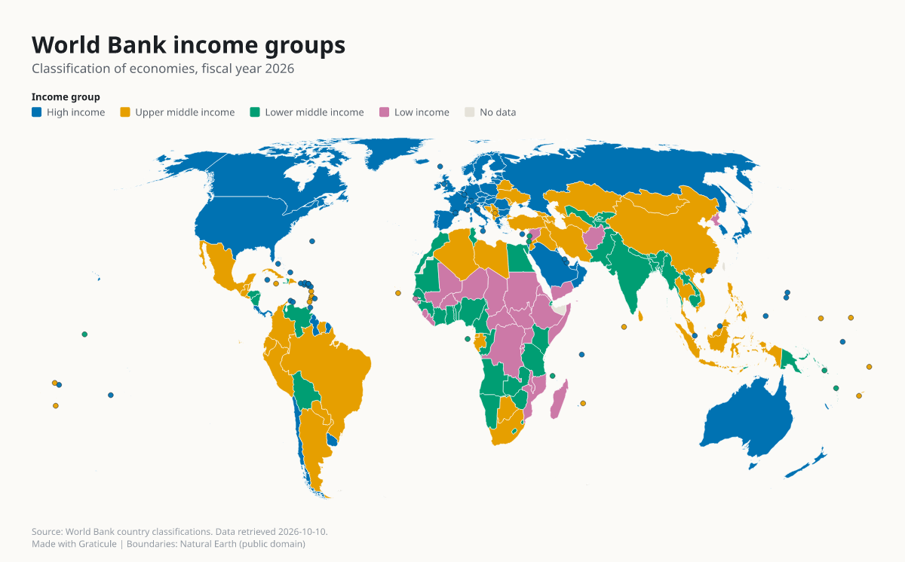

Prompt: "Color countries by World Bank income group."

Region `world`, type `categorical`. Checker notes: join-unmatched. [Spec](../gallery/income-groups/spec.json), [data](../gallery/income-groups/data.csv), [check log](../gallery/income-groups/check.json).

## Births per woman

Prompt: "Compare fertility rates by country in 1990, 2000, 2010 and 2022 side by side."

Region `world`, type `small-multiples`. Checker notes: join-unmatched. [Spec](../gallery/fertility-small-multiples/spec.json), [data](../gallery/fertility-small-multiples/data.csv), [check log](../gallery/fertility-small-multiples/check.json).

## GDP per person in Europe, 2022

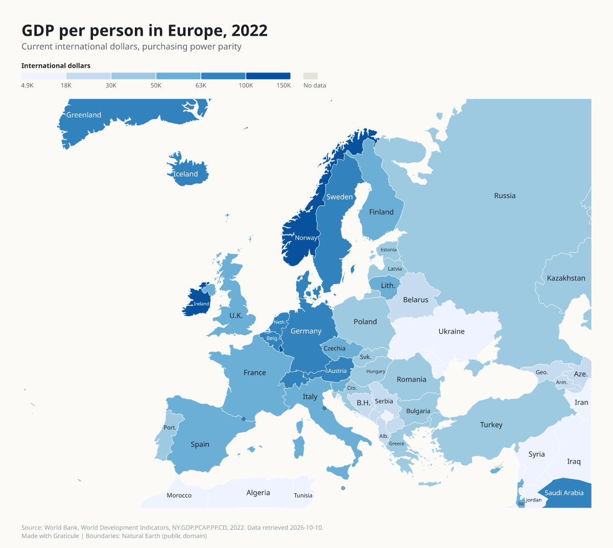

Prompt: "Map GDP per person in Europe."

Region `europe`, type `choropleth`. The checker found nothing to report. [Spec](../gallery/europe-gdp-per-capita/spec.json), [data](../gallery/europe-gdp-per-capita/data.csv), [check log](../gallery/europe-gdp-per-capita/check.json).

## Utilisateurs d'internet, 2022

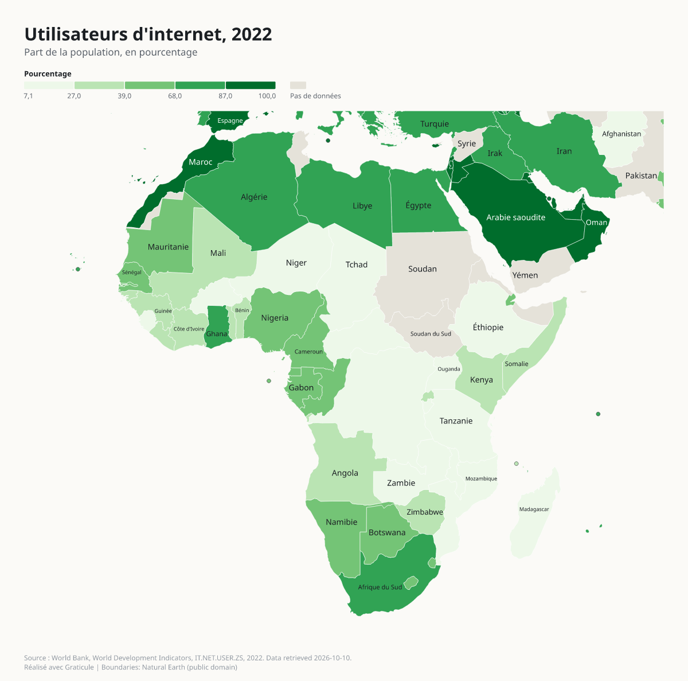

Prompt: "Show internet use across Africa, labels in French."

Region `africa`, type `choropleth`. Labels in French. The checker found nothing to report. [Spec](../gallery/africa-internet-users/spec.json), [data](../gallery/africa-internet-users/data.csv), [check log](../gallery/africa-internet-users/check.json).

## Esperanza de vida al nacer, 2019

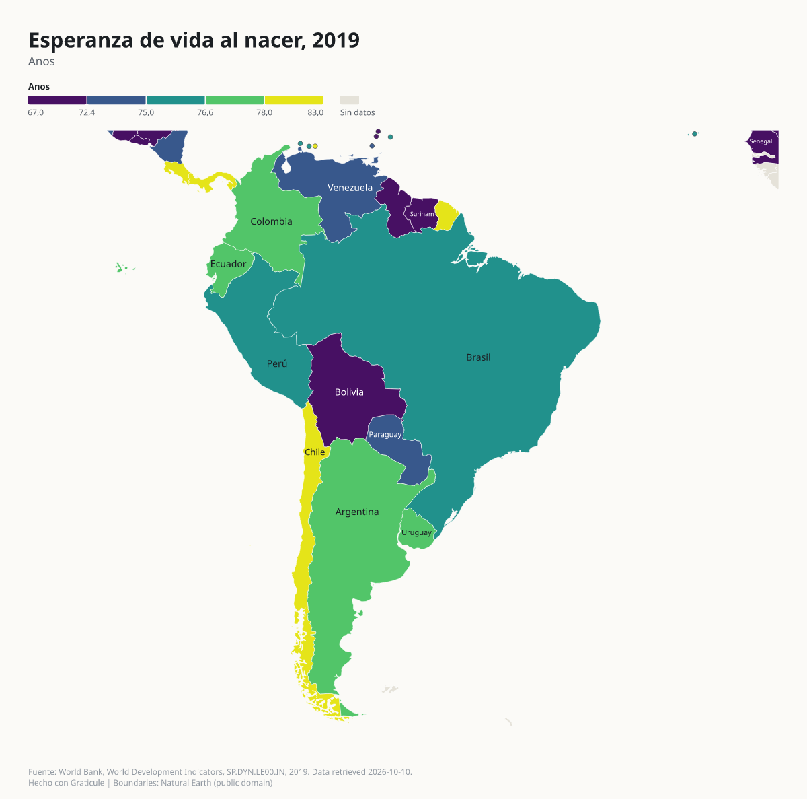

Prompt (asked in Spanish): "Life expectancy in South America, with names in Spanish."

Region `south-america`, type `choropleth`. Labels in Spanish. Checker notes: join-unmatched. [Spec](../gallery/south-america-life-expectancy/spec.json), [data](../gallery/south-america-life-expectancy/data.csv), [check log](../gallery/south-america-life-expectancy/check.json).

## Population density by state, 2023

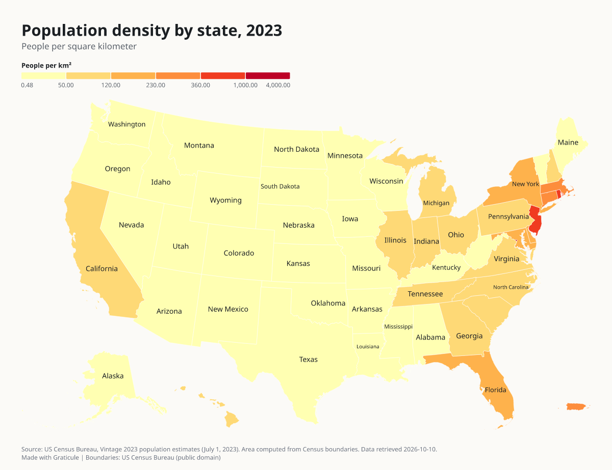

Prompt: "Map population density by US state."

Region `us-states`, type `choropleth`. The checker found nothing to report. [Spec](../gallery/us-state-density/spec.json), [data](../gallery/us-state-density/data.csv), [check log](../gallery/us-state-density/check.json).

## Unemployment rate by county, 2016

Prompt: "Show unemployment by county for the whole US."

Region `us-counties`, type `choropleth`. The checker found nothing to report. [Spec](../gallery/us-county-unemployment/spec.json), [data](../gallery/us-county-unemployment/data.csv), [check log](../gallery/us-county-unemployment/check.json).

## taiwan-township-area

Prompt (asked in Traditional Chinese): "Map the area of every Taiwan township and district, in Traditional Chinese."

Region `tw-towns`, type `choropleth`. Labels in Traditional Chinese. The checker found nothing to report. [Spec](../gallery/taiwan-township-area/spec.json), [data](../gallery/taiwan-township-area/data.csv), [check log](../gallery/taiwan-township-area/check.json).

## taiwan-locator

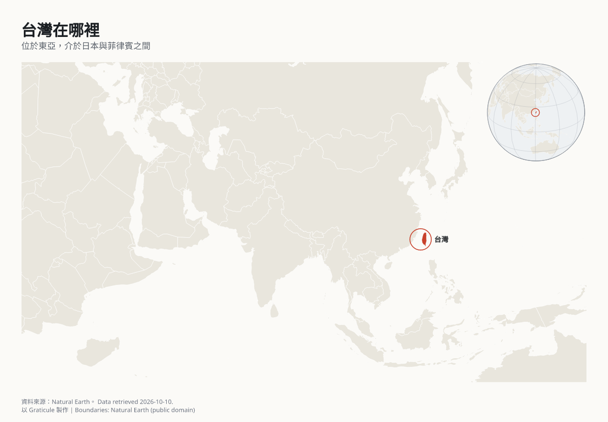

Prompt: "Show where Taiwan is, in Traditional Chinese."

Region `asia`, type `locator`. Labels in Traditional Chinese. The checker found nothing to report. [Spec](../gallery/taiwan-locator/spec.json), [data](../gallery/taiwan-locator/data.csv), [check log](../gallery/taiwan-locator/check.json).

## japan-regions

Prompt (asked in Japanese): "Color the Japanese prefectures by region."

Region `jp-prefectures`, type `categorical`. Labels in Japanese. The checker found nothing to report. [Spec](../gallery/japan-regions/spec.json), [data](../gallery/japan-regions/data.csv), [check log](../gallery/japan-regions/check.json).

## korea-capital-region

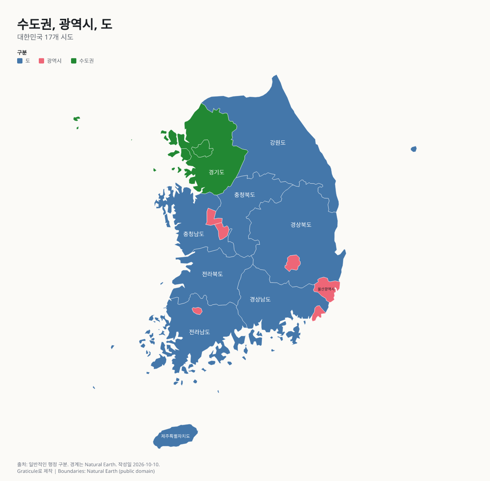

Prompt (asked in Korean): "Color the South Korean provinces as capital region, metropolitan cities and provinces."

Region `kr-provinces`, type `categorical`. Labels in Korean. The checker found nothing to report. [Spec](../gallery/korea-capital-region/spec.json), [data](../gallery/korea-capital-region/data.csv), [check log](../gallery/korea-capital-region/check.json).

## People per square kilometre in Brazil

Prompt: "Map how crowded each Brazilian state is. The boundaries are in states.topojson."

Region `custom`, type `choropleth`. The checker found nothing to report. [Spec](../gallery/brazil-state-density/spec.json), [data](../gallery/brazil-state-density/data.csv), [check log](../gallery/brazil-state-density/check.json).
